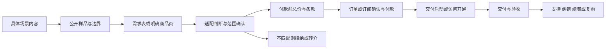

# 从真实能力到可信交易的人设设计框架

这一轮案例更支持一个可检验的判断：有效的人设，是让买家更容易判断“这个人能否替我解决这件事”的一组稳定线索。单独模仿文风、配色或身份称号，没有补上产品和交付，无法从这些案例推出会成交。

这是研究者的跨案框架，不是已经证明有效的增长公式。个案事实和来源见 [案例索引](../cases/README.md)，证据边界见 [研究方法](../docs/methodology.md)。

## 先选交易，再选角色

用一句话写出：**为哪类人，在什么触发场景，把什么输入变成什么可验收结果。** 例如“为需要重复导出报表的小团队，排查一个已复现的刷新/保存流程，并交付演示、修改说明和回退办法”。这比“AI 专家”“商业认知博主”更容易让新人的能力被检验，也更容易知道客户是否合适。

把角色设为自己当前能够承担的责任。尚在练习时，可以做有真实过程的实践者；熟练解决某个窄问题后，可以做专项执行者；有足够证据和经验后，再承担诊断、教学或顾问职责。角色升级以交付记录为依据，不以头像和标题升级。

| 角色 | 买家要检查的证据 | 能售卖的边界 | 容易失真的地方 |
|---|---|---|---|
| 实践者 | 自己完成的练习、失败与修复 | 透明范围的小任务或整理材料 | 将自己的练习写成客户案例 |
| 专项执行者 | 同类输入输出、验收与改动记录 | 固定范围交付、明确修改次数 | 用单一成功样例承诺所有环境 |
| 筛选/解释者 | 原始来源、筛选准则、更新与纠错 | 帮人节省核对和理解时间 | 用AI汇总冒充独家研究 |
| 资深顾问/连接者 | 真实职业经历、授权案例与资源 | 高不确定性诊断、团队协作 | 称号高于实际能力或可调用资源 |

## 设计“判断线索”，不要只设计外观

先列客户购买前的五个疑虑，再给每个疑虑一份可以检查的证据。

| 买家疑虑 | 内容证据 | 对应交易设计 | 如何判断是否起作用 |
|---|---|---|---|
| 你理解我的场景吗？ | 一个带限制条件的真实问题及错误尝试 | 需求表先问场景、已有办法与限制 | 咨询能否提供具体输入，而非只问“怎么赚钱” |
| 你真的会做吗？ | 输入→处理→输出，关键步骤可复现 | 样品、演示或试读可先看 | 买家能准确描述交付物，减少误解 |
| 为什么找你？ | 在一个窄场景连续解决相似难点 | 商品名称与作品对应 | 合格需求占比和相同问题的复现频率 |
| 价格包含什么？ | 成本来源、范围和不可承诺项 | 明示单位、总成本、另付项与修改限制 | 因费用预期错误产生的流失/退款 |
| 付完之后怎么办？ | 验收表、时间线、修订与纠错实例 | 发货、访问期限、支持及退款规则 | 实际交付时间、返工、售后与复购 |

Designjoy 的作品、排队和暂停机制是一组相连的信任线索；TypingMind 的许可与 API 费用需要分开解释；Dense Discovery 的支持档说明高档并不必然买到更多专业交付。这些是不同交易结构，不能统一套成“低价引流—高价收割”。见各案来源。

视觉服务于这组判断：封面让人认出主题，图表让步骤可检查，作品让质量可比较，持续版式降低阅读成本。是否露脸由所需证据决定；这批样本大多仍有真实姓名、照片、视频或职业经历，**没有证明纯匿名账号可获得同等信任与价格**。

## 内容要与商品同题

一个起步栏目可以围绕同一种交付做四类内容：问题诊断、过程展示、边界反例、使用结果。每篇末尾只连接与该篇问题相符的下一步，例如查看同类样品或提交需求。避免用宽泛的致富情绪吸引人，再承接完全不同的产品。

对同一题目，可以做图文步骤、错误对照、清单和短演示。AI 可帮助把已核实的同一份材料改为不同格式，不能将大量改写当成大量新增证据。原始素材、适用版本和纠错记录要能追溯。

## 把成交路径画到交付以后

信息产品可以直接从商品页进入结账；定制服务应先确认范围。不要为了套漏斗添加不必要的群聊、电话或高压咨询。买断、年订阅、服务月费和按次报价是不同合同：每一种都应写清访问/服务期限、费用单位、自动续费、额外成本、交付时限、修改和退款。

订单与付款节点属于后续业务设计，本轮未实付。真实业务需核商品版本、应付总额、续费选择、支付状态及收据；未付款或支付失败不能当成交，也不能假定访问已开通。取消和退款应能对应到原订单。

价格梯度按**真实新增价值或成本**划分：自助材料→特定任务代做→需要判断与持续支持的服务。起步没有能力交付后两层时，只卖一层。多个独立产品也不等于同一客户会逐层购买；本轮没有这些账号的完整客户迁移数据。

## 如何检验人设是否带来溢价

先找到交付、客户、使用场景相近的替代方案，比较总成本和边界。再记录买方选择原因：是样品、专长、及时响应、减少协调、独家资料、作者身份，还是折扣、礼包、平台推荐？不能把所有购买动机归给人设。

可在后续获授权试验中保持商品、价格与渠道尽量相同，只改变“证据呈现”方式，比较合格咨询、成交、返工和退款。小样本只能发现线索；流量来源、客户质量和时段差异都会混淆结果。真实溢价需同等交付的比较、支付结果和可持续成本，单个高价标签不够。

## 一页设计卡

| 要填的内容 | 填写标准 |
|---|---|
| 服务对象与触发场景 | 具体到什么人、什么时候需要解决 |
| 当前可信角色 | 用现有能力与证据支撑的一句话 |
| 三份证明 | 样品、可复现过程、失败/边界各一份 |
| 核心商品 | 输入、输出、期限、验收、修改、排除项 |
| 价格与总成本 | 币种/计费单位/另付项/续费及退款 |
| 内容栏目 | 每篇解决的疑虑及对应下一步 |
| 首次触达 | 买家在哪里看到、对应场景内容、如何进入样品或需求页 |
| 承接与交付 | 谁回复、要什么资料、如何存档和验收 |
| 成交确认 | 商品版本、应付总额、续费选择、支付状态、收据及开通状态 |
| AI 与本人分工 | AI辅助步骤、人工检查点、必须本人负责的判断 |
| 首个验证 | 最小投入、成功信号、停止条件和还缺的证据 |

填不出“证明”或“验收”时，应先做作品与交付练习；只有内容产量上升，不能替代这两个缺口。
